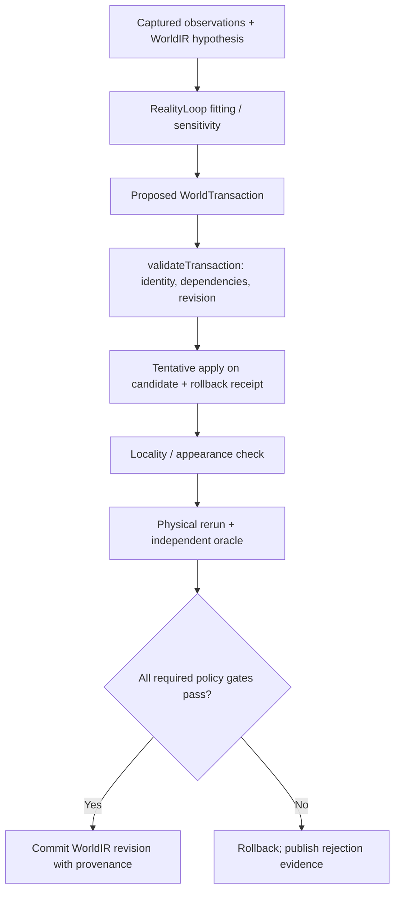

# Reality Probe / VULKAX — from a plausible reconstruction to a tested counterfactual

Read this with [the complete source-reading map](SOURCE_READING_ORDER.md),
[`research/README.md`](../research/README.md) and the explicit
[`DCS limitations and kill criteria`](../research/status/DCS_LIMITATIONS_AND_KILL_CRITERIA.md).
This is an explanation of code paths and scientific inference boundaries.
**It does not revise the frozen 2026-09-21 scientific snapshot or its claims.**

## 1. Why reconstructing appearances is insufficient

A fitted 3D captured world may reproduce all observed images while
containing incorrect masses, constraints, material properties or dynamics.
Its rendering agreement therefore does not establish correct behavior
under a physical intervention. Reality Probe distinguishes:

- **Observational fit**: how well a forward model predicts the measurements
  used to calibrate a world.
- **Counterfactual prediction**: what the same world predicts when a
  controlled intervention changes physical conditions.
- **Independent verification**: whether a withheld or separately produced
  physical measurement agrees within a declared tolerance.
- **Decision**: whether a proposed world edit is supported, vetoed, or
  unresolved when evidence is insufficient.

These are distinct evidence types; one cannot stand in for another.



The diagram covers one verified-rewrite path. The research support/veto/
unresolved classification and experimental protocol have additional
requirements; do not equate a `Verified` software flag with a
general scientific conclusion.

## 2. World state is structured, revisioned and inspectable

Start with
[`include/vulkax/world/world_ir.hpp`](../include/vulkax/world/world_ir.hpp)
and
[`include/vulkax/world/correspondence_graph.hpp`](../include/vulkax/world/correspondence_graph.hpp).
`WorldIR` holds entities, appearance primitives, observations, parameter
values and revision provenance. A stable Gaussian or entity identity is
not its index inside a vector. The correspondence graph links those
identities so an edit can identify affected appearance and physical
properties.

[`src/world/transaction.cpp`](../src/world/transaction.cpp) implements
a three-stage edit:
`validateTransaction` checks nonempty transaction identity,
expected revision, duplicate provenance IDs, correspondence integrity
and typed edits. `applyTransaction` records original touched positions,
materials and constraints, updates a **candidate copy**, increments
revision and appends provenance before publishing. `rollbackTransaction`
restores the previous state but requires its receipt to match the
currently applied revision.

**Exercise:** make a transaction referencing a missing entity or stale
revision. Confirm validation rejects it without mutation. Then apply
a valid translation and use a receipt to roll back, checking stable IDs
and untouched Gaussian positions.

## 3. Fit a world hypothesis without claiming physical truth

[`src/world/reality_loop.cpp`](../src/world/reality_loop.cpp)
contains `fitWorldHypothesis`, residual evaluation and local
identifiability analysis. A `ForwardModel` predicts selected
observations, and fitting minimizes a weighted residual objective.

Finite-difference columns form a Jacobian with respect to chosen
parameters; damped normal equations propose steps and the solver
checks trial changes. The observation roles matter: a role used for
fitting is not an independent validation role merely because the same
measurement was recorded twice.

`analyzeLocalIdentifiability` uses a scaled local Jacobian spectrum to
identify near-null directions. If several parameter combinations
produce nearly indistinguishable observations, a small residual alone
cannot uniquely establish mass/stiffness/constraint properties.

**Exercise:** construct two parameterizations that agree on training
measurements but respond differently to a withheld perturbation.
Compare fit residual, sensitivity rank and holdout prediction.

## 4. The verified rewrite is a gate, not a visual improvement score

[`src/world/verified_rewrite.cpp`](../src/world/verified_rewrite.cpp)
implements `executeVerifiedRewrite`. It first validates the transaction,
requires a physical verifier before mutating state when the policy
requires rerunning, and keeps a pre-edit Gaussian appearance snapshot.
After tentative application it checks untouched-region position drift
by **stable Gaussian IDs**, not array positions.

The caller-provided `PhysicalRewriteVerifier` can return a rerun result,
independent oracle status, scalar observable error/tolerance and an
evidence artifact identifier. The function requires all configured
locality, appearance, physical and oracle gates. An exception from the
verifier becomes rejection evidence. A failed gate triggers
`rollbackTransaction` and leaves `worldCommitted=false`.

The software status `RewriteVerificationStatus::Verified` is conditional
on the declared policy and supplied verifier. It cannot demonstrate
counterfactual accuracy where the protocol did not measure it.

**Exercise:** run the same transaction with a missing verifier, with
nonfinite observable error, with a failing independent oracle, and
with all configured gates passing. Confirm that the world revision
changes only in the accepted case and that every failure is recorded.

## 5. Numerical convergence and trust states

[`src/verify/convergence.cpp`](../src/verify/convergence.cpp)
computes an observed three-level convergence order from coarse,
medium and fine results under a declared refinement ratio. Roughly,

```text
p = log(abs((coarse - medium)/(medium - fine))) / log(r)
```

and a Richardson-style extrapolation estimates the fine-resolution
error. The inputs must be compatible quantities in an asymptotic
convergence regime. Oscillating/nonconvergent differences, invalid
ratios and singular extrapolation are rejected. Even a well-defined
estimate does not establish true continuum accuracy without a
sufficient refinement study and independent solution.

[`src/verify/result_certificate.cpp`](../src/verify/result_certificate.cpp)
represents configured numeric criteria with finite thresholds and
comparison direction. The `Preview/Converging/Verified/Rejected`
state machine checks mandatory criteria and a convergence-complete
indicator. This is a local evidence contract, not proof of model
identifiability or correctness in unobserved settings.

**Exercise:** vary timestep and spatial resolution independently,
then try nonmonotonic triples. A real convergence claim needs
observed-order stability, rather than assuming small absolute error
in one chosen run.

## 6. Link capture, solver, Gaussian and physical validation

Follow [`src/capture`](../src/capture),
[`src/world`](../src/world), [`src/solvers`](../src/solvers),
[`src/inverse`](../src/inverse),
[`src/experiment`](../src/experiment) and
[`src/research`](../src/research), in that order.

The numerical methods can include finite elements, particles/MPM,
diffusion, granular solvers and Gaussian rendering. Each has its own
state discretization, integration step, stability bounds, and forward
observable. A physically meaningful intervention must be mapped to
the actual solver inputs and observation units.

Read
[`tests/verified_rewrite_tests.cpp`](../tests/verified_rewrite_tests.cpp),
[`tests/captured_reality_loop_tests.cpp`](../tests/captured_reality_loop_tests.cpp),
[`tests/metric_video_bounce_tests.cpp`](../tests/metric_video_bounce_tests.cpp),
[`tests/timestep_convergence_tests.cpp`](../tests/timestep_convergence_tests.cpp)
and [`tests/mpm_world_tests.cpp`](../tests/mpm_world_tests.cpp).
Check the separate output/measurement/holdout evidence used by each.

## 7. The critical scientific limitations must travel with the code

The publication-facing research snapshot is
`paper-freeze-2026-09-21`, commit
`a9da8c0aa8689ebeea0d84baf95a74907659a837`.
The current main/teaching branches contain later verification,
visualization or documentation; they do not retroactively change
the frozen scientific test decisions.

The repository's existing evidence reports different outcomes across
experiments: pendulum behavior can be supported in its tested regime,
while a free-fall validation **failed** and temporal downsampling can
materially degrade accuracy. A successful training residual or one
rerun must not conceal these negative findings.

Read [`research/paper_data/REPRODUCIBILITY_CHECKLIST.md`](../research/paper_data/REPRODUCIBILITY_CHECKLIST.md)
and [`research/status/DCS_LIMITATIONS_AND_KILL_CRITERIA.md`](../research/status/DCS_LIMITATIONS_AND_KILL_CRITERIA.md)
before writing claims. Preserve negative/UNRESOLVED outcomes, unknown
oracle independence and experiment scope.

For every claim record: source SHA/tag, scene/observation dataset,
parameter and intervention definitions, seed, timestep/mesh size,
calibration/validation split, independent oracle, measured error and
threshold, uncertainty, exact command and host. A good visualization
is not evidence of physical validity on its own.

*Verification note: this teaching artifact reflects source inspection on a
documentation branch. No new physics results or build/test successes are
claimed, and no frozen evidence files were modified.*
